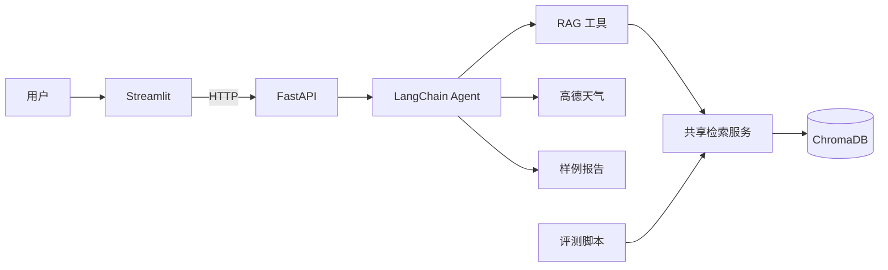
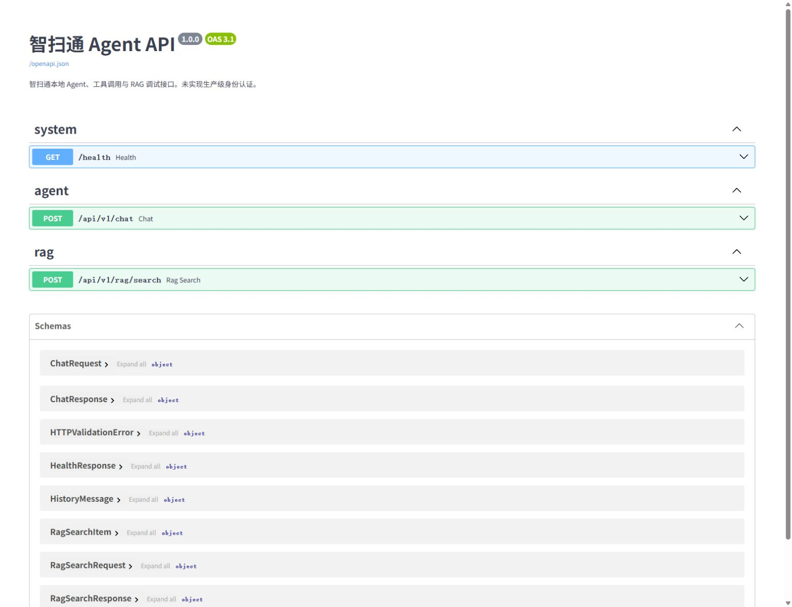
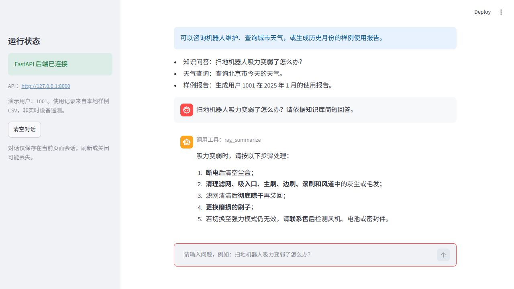

# 智扫通——基于 FastAPI、LangChain 与 RAG 的智能客服 Agent

GitHub：<https://github.com/zhibo888/zhisaotong-agent-fastapi-rag>

智扫通是面向扫地/扫拖机器人场景的本地智能客服演示系统。Streamlit 提供聊天界面，FastAPI 提供稳定的 HTTP 服务边界，LangChain Agent 负责工具决策，ChromaDB 提供知识检索。

当前实现包括知识问答、城市天气、服务端出口 IP 近似定位、样例设备报告、会话上下文、独立 RAG 检索接口和可复现的检索评测。样例报告来自本地合成 CSV，不是实时设备遥测。

## 架构



完整架构与数据流见 [docs/architecture.md](docs/architecture.md)。页面在后端返回完整结果后显示回答，不宣称模型 token 级流式输出。

## 主要接口

| 方法 | 路径 | 用途 |
|---|---|---|
| GET | `/health` | 轻量存活检查，不初始化模型 |
| POST | `/api/v1/chat` | Agent 对话，返回 `answer` 与 `tools_used` |
| POST | `/api/v1/rag/search` | 检索调试，返回来源、片段和 distance |

Swagger：<http://127.0.0.1:8000/docs>。当前 API 仅用于本地开发，未实现生产级登录、鉴权、限流和 TLS。

对话请求示例：

```json
{
  "query": "扫地机器人吸力变弱了怎么办？",
  "history": [{"role": "user", "content": "请依据知识库回答"}]
}
```

## 技术栈

- Python 3.13
- FastAPI 0.143.0、Uvicorn 0.53.0、HTTPX 0.28.1
- Streamlit 1.64.0
- LangChain 1.4.2、LangGraph 1.2.12
- ChromaDB 1.5.9、langchain-chroma 1.1.0
- ChatTongyi `qwen3-max`、DashScope `text-embedding-v4`

版本固定在 `requirements.txt`。测试依赖在 `requirements-dev.txt`。

## 目录

```text
.
├── api/                         # FastAPI 路由、Schema、服务边界
├── agent/                       # ReactAgent 与七项工具
├── rag/
│   ├── vector_store.py          # 入库与共享检索
│   ├── rag_service.py           # RAG 总结
│   └── evaluation/              # 数据校验、指标、评测输出
├── scripts/evaluate_rag.py
├── data/
│   ├── demo_knowledge.txt
│   ├── evaluation/rag_eval.jsonl
│   └── external/records.csv
├── reports/rag_evaluation/
├── tests/
├── docs/
├── app.py
└── requirements.txt
```

`chroma_db/`、`md5.text`、`.local/` 和日志属于本机运行数据，不提交。现有 Chroma 与 MD5 不需要删除或重建。

## 安装与环境变量

```powershell
python --version
python -m pip install -r requirements-dev.txt
python -m pip check
```

程序读取进程环境变量，不自动读取 `.env`：

```powershell
$env:DASHSCOPE_API_KEY = "你的 DashScope Key"
$env:AMAP_API_KEY = "你的高德 Web 服务 Key"   # 天气功能需要
$env:AGENT_API_BASE_URL = "http://127.0.0.1:8000" # 可选
```

不要把真实 Key 写入源码、YAML、`.env.example`、日志或截图。

## 初始化知识库

```powershell
python -m rag.vector_store
```

该命令会调用 Embedding，可能产生服务费用。公开候选只附带品牌无关的 `data/demo_knowledge.txt`；本机可继续使用已有且有权使用的 PDF/TXT。扫描型 PDF 不支持 OCR。修改模型或分块配置时先备份现有 Chroma 与 MD5，再在配置中使用新的持久化目录。

## 启动

分别打开两个 PowerShell 终端，在项目根目录执行：

```powershell
# 终端 1：后端
python -m uvicorn api.main:app --host 127.0.0.1 --port 8000
```

```powershell
# 终端 2：前端
python -m streamlit run app.py --server.address 127.0.0.1 --server.port 8501
```

访问 <http://127.0.0.1:8501>。侧栏显示“FastAPI 后端已连接”后即可提问；后端不可用时输入框会停用，并显示启动命令。

## RAG 检索评测

评测集位于 `data/evaluation/rag_eval.jsonl`。公开知识只有 7 个主题，因此当前提供 14 条有证据依据的草案问题，没有人为扩充到 30–50 条。所有标签标记为 `draft`，尚不能作为正式质量结论。

默认命令只评测 `reviewed` 样本；当前会输出 `PENDING`：

```powershell
python -m scripts.evaluate_rag
```

显式纳入草案可生成探索性结果：

```powershell
python -m scripts.evaluate_rag --include-draft
```

输出包括 `summary.json`、`query_results.csv`、`rag_evaluation_report.md`、`metrics.svg`、人工答案评分模板和评分说明。人工表使用 0/1/2 三档评价正确性、证据支持、无依据内容和完整性，不预填答案或分数。检索指标为 Hit、Recall、MRR@1/3/5，并记录每题延迟、P50/P95 和错误类型。

2026-10-09 对本机 330 向量索引的草案运行结果：Hit@1 **0.2857**，Hit@3 **0.5000**，Hit@5 **0.5714**；P50 **140.77 ms**，P95 **378.31 ms**，14 条查询、0 错误。完整结果见 [RAG 评测报告](reports/rag_evaluation/rag_evaluation_report.md)。该索引还包含 6 份本地旧资料，存在来源竞争；正式发布前应复核标签，并在公开数据单独构建的索引上复测。

## 测试

```powershell
python -m compileall -q app.py api agent rag model scripts utils tests
python -m pytest -q -m "not live"
```

真实服务测试需显式启用，会调用 DashScope/高德并可能产生费用：

```powershell
$env:RUN_LIVE_TESTS = "1"
python -m pytest -q -m live
Remove-Item Env:RUN_LIVE_TESTS
```

离线测试覆盖 FastAPI Schema、错误脱敏、请求隔离、Streamlit HTTP 客户端、工具、索引恢复与 RAG 指标边界。真实测试通过 FastAPI 同时验证 Agent 与 RAG 检索接口。

## 功能示例

1. `扫地机器人吸力变弱了怎么办？请依据知识库回答。`
2. `查询北京市今天的天气。`
3. `生成用户 1001 在 2025 年 1 月的使用报告。`
4. `生成用户 1001 在 2099 年 1 月的报告。` 应明确无记录，不编造指标。

2026-10-09 已在真实浏览器验证 Swagger 三个路由及 Streamlit → FastAPI → Agent → RAG 完整链路。





既有功能截图与说明见 [截图清单](docs/screenshots/README.md)。

## 边界

- 无生产级身份认证、TLS、限流、跨会话持久历史或实时设备接入。
- 长历史限制为 20 条、合计 16000 字符；问题最大 4000 字符。
- RAG 检索接口最多返回 20 个结果，`distance` 越小越相似，不是概率。
- 知识内容不能代替具体型号说明书或专业维修判断。
- `langchain-community` 当前会产生弃用提示，迁移需单独评估。

## 来源与发布

本项目在原工程基础上进行复现和工程化升级。原 README 指向 [bamboo-moon/zhisaotong-Agent](https://github.com/bamboo-moon/zhisaotong-Agent)，相关来源与贡献边界记录在 [docs/ATTRIBUTION.md](docs/ATTRIBUTION.md)。上游仓库没有可识别的独立 LICENSE，因此没有擅自新增许可证；授权不明的上游知识文档不进入公开候选提交。
