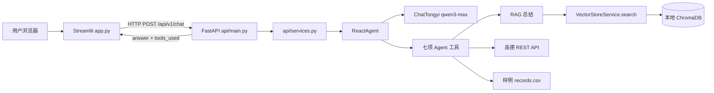
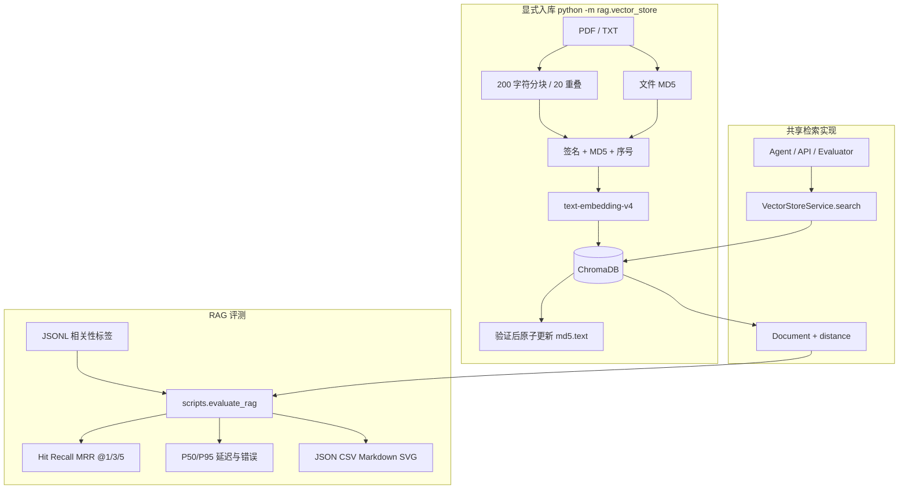

# 系统架构

## 在线请求链路

Streamlit 只保存当前页面会话并调用 HTTP API，不再导入或初始化 Agent。后端是非流式接口：一次请求返回完整回答和工具名称。`GET /health` 只做存活检查，不创建模型；`POST /api/v1/chat` 执行 Agent；`POST /api/v1/rag/search` 暴露检索结果、来源和 Chroma distance。API 当前面向本地开发，未实现生产身份认证。

每次请求都从请求体取得独立历史，最多 20 条、合计 16000 字符。报告模式上下文仍只作用于本次 Agent 调用。异常在 API 边界转换为固定提示，响应与前端不包含原始异常、Key 或远端响应正文。

## 索引与评测链路

Agent、调试 API 和评测器共用 `VectorStoreService.search`，避免测试另一套检索逻辑。Chroma 返回的是 distance，越小越相似；排名指标不把它解释为概率。相关标签以来源文档为粒度，K 按原始切片排名计算，同一来源重复出现不会重复增加 Recall。

索引签名包含 Embedding 模型与分块配置。不兼容索引会拒绝混写。MD5 只是完成记录，Chroma 中的确定性 ID 才是去重依据；现有数据库和 MD5 不会由在线服务或评测脚本删除。
